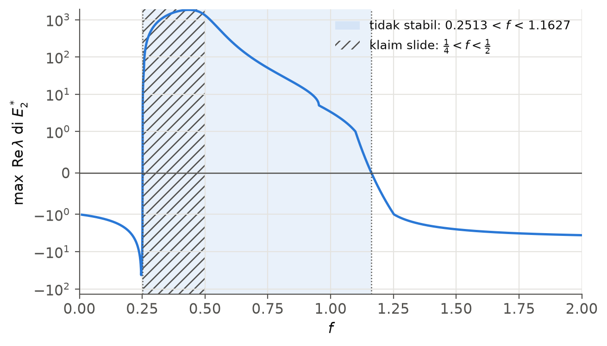
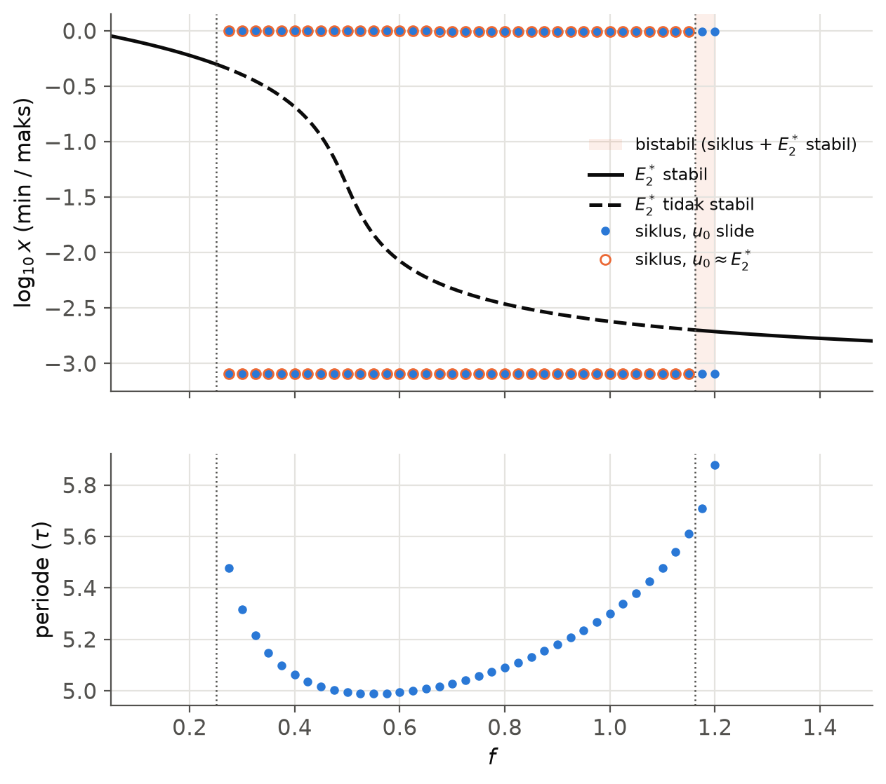
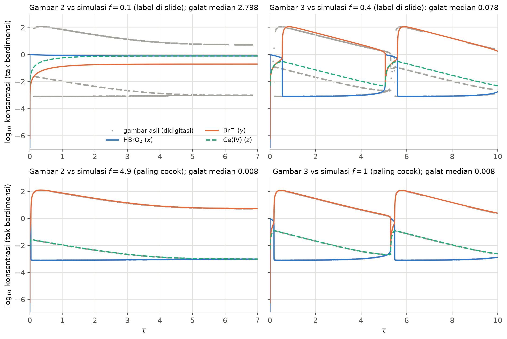

# Oregonator: stability and Hopf bifurcation of the Belousov–Zhabotinsky reaction

**Slides:** [slides/slide.pdf](slides/slide.pdf) (corrected) · [original/](original/) (June 2024, as submitted) ·
**Numbers:** [results/summary.json](results/summary.json)

This repository is a from-scratch reproduction of a Dynamical Systems
(*Sistem Dinamik*) mini project at Universitas Gadjah Mada (Kelompok 2, June
2024). The project analysed the stability of the three-variable Oregonator
model of the Belousov–Zhabotinsky (BZ) reaction and claimed that it oscillates
for 1/4 < f < 1/2. Only the Beamer source and two MATLAB screenshots
survived, so every derivation was redone in SymPy and every simulation was
rewritten in Python (SciPy, Radau). Doing so corrected several errors in the
original slides.

The scaled model is

```
dx/dτ = (q y − x y + x(1 − x)) / ε      x = [HBrO2] / X0
dy/dτ = (−q y − x y + 2 f z) / δ        y = [Br−] / Y0
dz/dτ = x − z                           z = [Ce(IV)] / Z0
```

with ε = 5×10⁻⁵, δ = 2×10⁻⁴, q = 8×10⁻⁴ in the simulations, and the
stoichiometric factor f as the bifurcation parameter.

## Findings

- **The oscillation interval is 0.2513 < f < 1.1627, not 1/4 < f < 1/2.**
  The upper Hopf point found with the Routh–Hurwitz condition AB − C = 0 is
  at f = 1.1627 for the simulation parameters. The slides' bound 1/2 is the
  limit q → 0 and is approached slowly (f = 0.692 at q = 8×10⁻⁶, 0.520 at
  8×10⁻⁸). It came from setting x\* ≈ 1 − 2f, which only holds for f < 1/2,
  and from an existence condition 1 − 2f − q > 0 that is not needed: the
  positive equilibrium E₂\* exists for every f > 0.
- **Oscillations also persist past the upper Hopf point.** For
  1.1627 < f < 1.202 the stable equilibrium coexists with the large
  relaxation cycle, so the outcome depends on the initial condition. From
  the slides' initial condition the reaction lands on the cycle at every
  sweep point from f = 0.275 to 1.2 (step 0.025), bistable part included;
  from a small perturbation of E₂\* it oscillates only up to the Hopf point.
- **The original figures were not made with the f values in their captions.**
  Digitising the two MATLAB screenshots and fitting f: "Gambar 2, f = 0.1"
  matches f ≈ 5 (4.9 on the grid, median error 0.008 decades; f = 0.1
  gives 2.80), and "Gambar 3, f = 0.4" matches f = 1.0 (0.008 vs 0.078 at
  f = 0.4). With f = 0.1 the system settles at x\* ≈ 0.8, about three
  decades above the plotted steady state. Both figures are regenerated here
  with the stated f.
- **The period at f = 0.4 is T ≈ 5.06 τ, not 6822.44.** The slides' value
  could not be reproduced from their formula, which is in any case the
  small-amplitude period 2π/√(C/A). That formula only holds at a Hopf point
  (0.140 at f = 0.2513, 1.405 at f = 1.1627); at f = 0.4 the oscillation is
  a relaxation oscillation with a much longer period.
- **Formula errors in the slides** (each one is checked in
  [tests/test_model.py](tests/test_model.py)):
  - ε = k₀B/(k₅A); the slides give the inverse, which would make ε ≫ 1.
  - The rate constants in the slides give q = 8×10⁻⁶ (a commented-out slide
    says 4×10⁻⁶); the simulations use q = 8×10⁻⁴.
  - x\* = (1 − 2f − q + √D)/2 with D = (1 − 2f − q)² + 4q(1 + 2f). The
    slides wrote 1 − f − q in x\* and y\*, which is not an equilibrium
    (for f = 0.1 it gives 0.850 instead of 0.800).
  - At E₁\* the coefficient of λ is (q(ε − 1) − δ)/(εδ), not
    (q(ε + 1) − δ)/(εδ). The conclusion (E₁\* is unstable) is unaffected:
    the constant term −q(1 + 2f)/(εδ) is negative.
  - x, y, z are dimensionless, so the initial values and the equilibrium
    (0.800, 0.200, 0.800) at f = 0.1 are not in mol/L.
  - The reference is Santoso, Apriliani and Usadha (2019), not
    "M. S. Amelia".
- **Confirmed.** The scaling of δ, q and the z equation; the coefficients A,
  B, C at E₂\* (up to typos); A > 0 and C > 0; the factorisation
  (λ + A)(λ² + C/A) at AB = C; E₁\* always unstable; f = 0.1 stable and
  f = 0.4 oscillating. Both Hopf points satisfy the transversality condition
  (d Re λ / df = +7.9×10³ and −13.5).

| | Slides (2024) | Reproduced |
|---|---|---|
| E₂\* exists for | 1 − 2f − q > 0 | every f > 0 |
| E₂\* at f = 0.1 | (0.798, 0.2, 0.798) | (0.800, 0.200, 0.800) |
| E₂\* unstable (Hopf points) | 1/4 < f < 1/2 | 0.2513 < f < 1.1627 |
| Stable relaxation cycle exists | 1/4 < f < 1/2 | 0.2513 < f < 1.202 |
| Period at f = 0.4 | 6822.44 | 5.06 τ |
| f behind "Gambar 2 (f = 0.1)" | 0.1 | ≈ 5 |
| f behind "Gambar 3 (f = 0.4)" | 0.4 | ≈ 1.0 |







## Reproduce

```bash
uv venv && uv pip install -e ".[dev]"
.venv/bin/python -m oregonator.report   # results/ and figures/; 10–30 min on 8 cores (--reuse skips the sweep)
.venv/bin/python -m pytest              # symbolic and numerical checks
cd slides && latexmk -pdf slide.tex     # corrected slides
```

| Path | Contents |
|---|---|
| `src/oregonator/model.py` | Vector field, Jacobian, E₂\*, characteristic coefficients A, B, C |
| `src/oregonator/symbolic.py` | SymPy derivation of the scaling, equilibria and characteristic polynomials |
| `src/oregonator/analysis.py` | Hopf points (AB − C = 0), transversality, linear period |
| `src/oregonator/simulate.py` | Radau integration, attractor range and period |
| `src/oregonator/digitize.py` | Reads the curves back out of the original MATLAB screenshots |
| `src/oregonator/report.py` | Writes `results/` and `figures/` |
| `slides/` | Corrected Beamer slides (same structure as the original) |
| `original/` | The June 2024 slides as submitted (student ID numbers removed) |

## Limitations

- The reference paper could not be retrieved (the ITS journal site did not
  resolve on 21 October 2026), so the derivations were checked against the
  model itself rather than against the paper.
- The f behind the original figures is fitted on a grid (step 0.05 below
  f = 1.5, 0.1 above) to curves digitised from JPEG-compressed screenshots.
- The bistable window was found by direct simulation from a point on the
  cycle and bisection (±0.001), not by numerical continuation (AUTO,
  MatCont). The first Lyapunov coefficient, which would classify each Hopf
  point as super- or subcritical, was not computed.

## Credits

Original project by Kelompok 2: Nimas Roro Ayuningsih, Vincentius Stanisluiz
Ferrel, Chatarina Hana Febriyanti, Kasih Bijaksana Karunia Ilahi and Moh Hasbi
Alfarizi. Reproduction by Moh Hasbi Alfarizi.

A. M. Santoso, E. Apriliani, I G. N. R. Usadha. Analisis Kestabilan dan
Bifurkasi Model Oregonator dari Reaksi Belousov–Zhabotinsky. *Jurnal Sains dan
Seni ITS* 8(1), 2019. [doi:10.12962/j23373520.v8i1.42118](https://doi.org/10.12962/j23373520.v8i1.42118)

R. J. Field, R. M. Noyes. Oscillations in chemical systems. IV. Limit cycle
behavior in a model of a real chemical reaction. *J. Chem. Phys.* 60, 1877
(1974).
